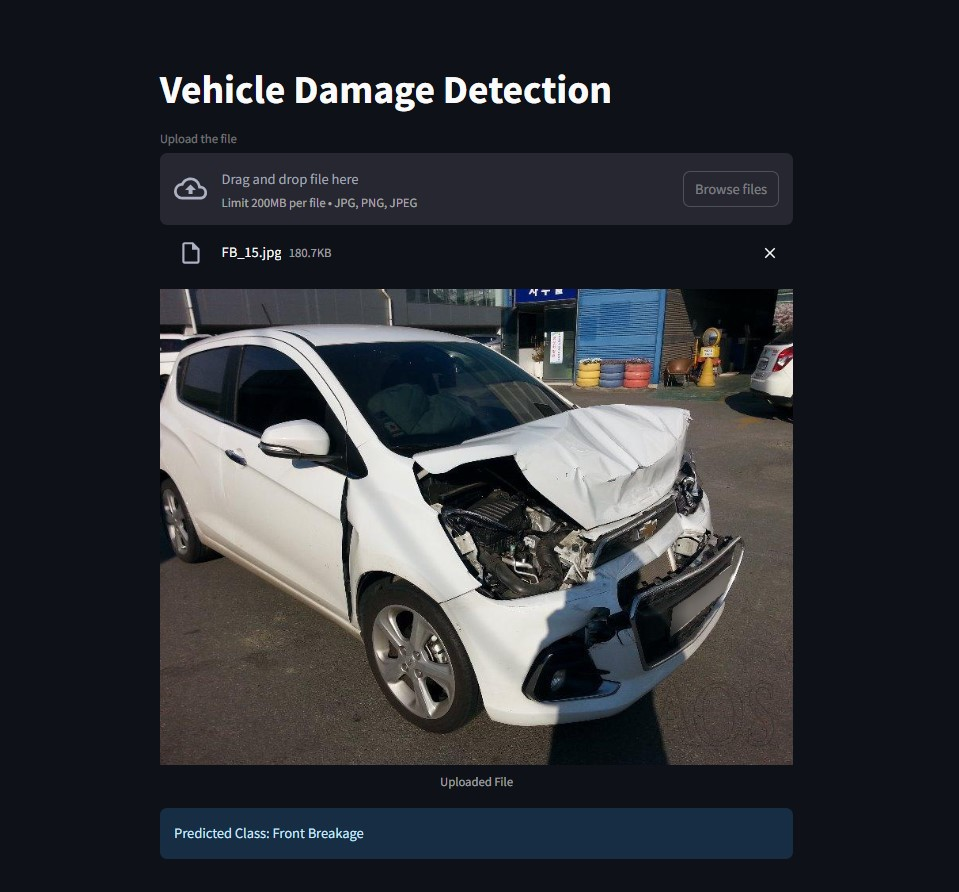
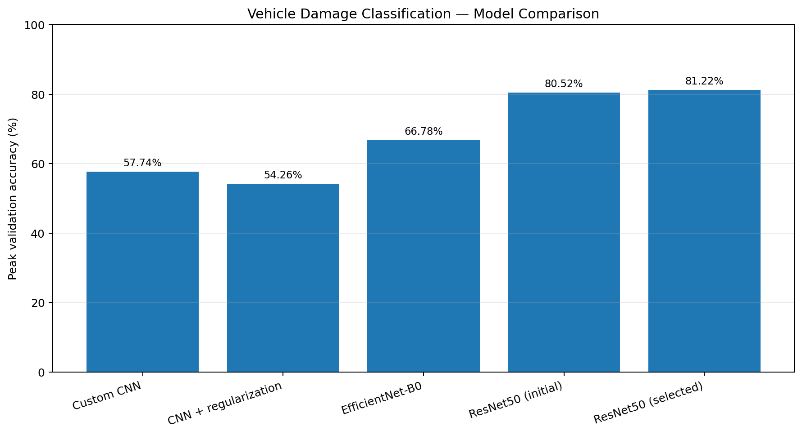
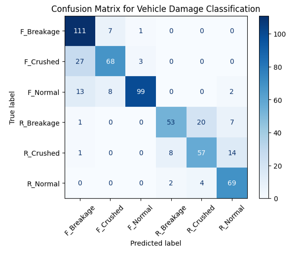

# Vehicle Damage Detection Using Deep Learning

A six-class vehicle image classification application built with PyTorch and ResNet50 transfer learning, with an interactive Streamlit interface.


[](https://vehicle-damage-detection-ai.streamlit.app/)
[](https://github.com/Saurabh136/Vehicle_Damage_Detection)

## 🚀 Live Application

**Try the application:** 
https://vehicle-damage-detection-ai.streamlit.app/

Upload a vehicle image and get an AI-powered damage classification across six categories.


## Project objective

Develop a deep learning model that classifies vehicle images into six categories based on vehicle view (front or rear) and condition (breakage, crushed, or normal).

**Achievement statement:** Implemented and deployed a six-class vehicle damage classifier using ResNet50 transfer learning. The selected training run reached a **peak validation accuracy of 81.22%**. Its final-epoch predictions produced **79.48% accuracy** and a **0.79 macro F1-score** on 575 validation images.

> The peak validation accuracy and the classification-report accuracy refer to different epochs. They are deliberately reported separately.


## Application Demo

[](https://vehicle-damage-detection-ai.streamlit.app/)

*Click the screenshot to launch the live application.*


## Dataset

The notebook records 2,300 images divided into a 75% training split and a 25% validation split.

| Dataset split | Images |
|---|---:|
| Training | 1,725 |
| Validation | 575 |
| **Total** | **2,300** |

### Classification classes

| Class ID | Class |
|---:|---|
| 0 | Front Breakage |
| 1 | Front Crushed |
| 2 | Front Normal |
| 3 | Rear Breakage |
| 4 | Rear Crushed |
| 5 | Rear Normal |

The images represent three-quarter front and rear vehicle views. Performance on substantially different camera angles or image conditions has not been established.

## Image preprocessing

The notebook uses the following Torchvision preprocessing pipeline:

- Random horizontal flip
- Random rotation up to 10 degrees
- Color jitter (brightness and contrast)
- Resize to 224 × 224 pixels
- Conversion to tensor
- Normalization using ImageNet mean and standard deviation

## Model experimentation

Several CNN architectures were implemented and compared.

| Model | Peak validation accuracy |
|---|---:|
| Custom CNN | 57.74% |
| CNN with Batch Normalization and Dropout | 54.26% |
| EfficientNet-B0 | 66.78% |
| ResNet50 — initial configuration | 80.52% |
| ResNet50 — selected configuration | **81.22%** |



These are the peak validation accuracies recorded for the respective experiments. They are not a controlled benchmark on an independent test set.

## Final architecture: ResNet50

The selected model uses an ImageNet-pretrained ResNet50 backbone.

The notebook's transfer-learning setup:
1. Loads pretrained ResNet50 weights.
2. Freezes the backbone parameters.
3. Unfreezes `layer4` for fine-tuning.
4. Replaces the original fully connected layer with a task-specific classification head.
5. Uses six output units for the six classes.

**Classification head:** `Dropout(0.2) → Linear(2048, 6)`

### Training configuration

| Parameter | Selected configuration |
|---|---|
| Model | ResNet50 |
| Optimizer | Adam |
| Loss function | CrossEntropyLoss |
| Learning rate | 0.005 |
| Dropout | 0.2 |
| Batch size | 32 |
| Training duration | 10 epochs |
| Input size | 224 × 224 |
| Fine-tuned layers | `layer4` and classification head |

## Hyperparameter tuning with Optuna

Optuna was used to explore learning rate and dropout rate.

| Setting | Value |
|---|---|
| Learning-rate search range | 1e-5 to 1e-2 (log scale) |
| Dropout search range | 0.2 to 0.7 |
| Trials | 20 |
| Epochs per trial | 3 |
| Recorded best learning rate | 0.000426645 |
| Recorded best dropout | 0.664010652 |

The selected final training configuration (learning rate 0.005 and dropout 0.2) came from a separate experiment. The notebook reports that the tested configurations showed limited accuracy differences; the Optuna result and selected final configuration are therefore reported separately.

## Evaluation

The classification report generated from the selected ResNet50 run's final-epoch predictions is shown below.

| Class | Precision | Recall | F1-score | Support |
|---|---:|---:|---:|---:|
| Front Breakage | 0.73 | 0.93 | 0.82 | 119 |
| Front Crushed | 0.82 | 0.69 | 0.75 | 98 |
| Front Normal | 0.96 | 0.81 | 0.88 | 122 |
| Rear Breakage | 0.84 | 0.65 | 0.74 | 81 |
| Rear Crushed | 0.70 | 0.71 | 0.71 | 80 |
| Rear Normal | 0.75 | 0.92 | 0.83 | 75 |
| **Macro average** | **0.80** | **0.79** | **0.79** | **575** |
| **Weighted average** | **0.81** | **0.79** | **0.79** | **575** |

**Overall accuracy: 79.48% (457 correct predictions out of 575).**

### Confusion matrix



The class-wise report indicates stronger recall for Front Breakage (0.93) and Rear Normal (0.92), while Front Crushed (0.69) and Rear Breakage (0.65) are more challenging classes. These are useful targets for further data collection and error analysis.

## Streamlit inference workflow

1. The user uploads a JPG, JPEG, or PNG vehicle image.
2. The image is converted to RGB.
3. The image is resized and normalized using the inference transforms.
4. The trained ResNet50 checkpoint generates class scores.
5. The application displays the predicted class.

## Technology stack

- Python
- PyTorch
- Torchvision
- NumPy
- Matplotlib
- Scikit-learn
- Optuna
- Streamlit
- Pillow

## Run locally

Clone the repository:

```bash
git clone YOUR_GITHUB_REPOSITORY_URL
cd vehicle-damage-detection
```

Create and activate a virtual environment:

```bash
python -m venv venv
```

Install dependencies:

```bash
pip install -r requirements.txt
```

Start the Streamlit application:

```bash
streamlit run app.py
```

## Repository structure

```text
vehicle-damage-detection/
├── app.py
├── model_helper.py
├── requirements.txt
├── README.md
├── model/
│   └── saved_model.pth
└── assets/
    ├── app_screenshot.jpg
    ├── confusion_matrix.png
    └── model_comparison.png
```

## Limitations and next steps

- The notebook applies random augmentation in the dataset pipeline before the train/validation split. Consequently, validation samples can receive stochastic augmentation. A stronger evaluation should use separate training and deterministic validation transforms.
- The validation split is not a substitute for a completely unseen test set.
- Use a stratified, reproducible split and report results across multiple seeds where practical.
- Investigate Front Crushed and Rear Breakage errors, where recall is lower.
- Consider class-balanced sampling or loss weighting if supported by further class-distribution analysis.
- Evaluate calibration and prediction confidence before using model outputs in consequential decisions.
- Add explainability (for example, Grad-CAM), input validation, logging, and monitoring.
- Consider a FastAPI inference service and containerized deployment for a more extensible serving architecture.

## Project outcome

This project covers an end-to-end image-classification workflow: data preprocessing, CNN experimentation, transfer learning, hyperparameter search, model evaluation, and deployment through Streamlit.
